# User Experience Design

This document has the app map and wireframes for the Minimum Viable Product (MVP) of CareerHive. They were made in [draw.io](https://draw.io). The source files and exported PNGs are in the [`ux-design`](./ux-design) folder:

- [`app-map.drawio`](./ux-design/app-map.drawio.xml): the app map
- [`wireframes.drawio`](./ux-design/wireframes.drawio): the main editable wireframe source, one page per screen
- [`wireframes.drawio.xml`](./ux-design/wireframes.drawio.xml): a matching XML copy; regenerate it from the main drawing after edits

## Prototype

**[View the clickable prototype on Figma](https://www.figma.com/proto/R4lliiZKlfzQkVtCScmLcN/CareerHive-Prototype?node-id=75-3&starting-point-node-id=75-3)**

The prototype was built in [Figma](https://www.figma.com/prototyping/) using all 24 wireframes below as its screens ([editor view](https://www.figma.com/design/R4lliiZKlfzQkVtCScmLcN/CareerHive-Prototype), page **Prototype (Oct 26)**). It starts on the **Welcome** screen. The October 18 version built from the old 21 wireframes is kept on a separate archive page.

**October 26 refresh (after presentation feedback):**

- Every screen is a 393 × 852 frame, presented inside Figma's iPhone 16 device frame. Each wireframe is scaled to the phone width, and taller screens scroll inside the phone instead of being squeezed.
- A fixed 54px status-bar area at the top keeps content clear of the camera notch. Short screens (Welcome, Log In, Sign Up, Browse Jobs, Deadlines, My Profile and their error states) fit the phone exactly with no scrolling; only empty space below their content was trimmed. Longer screens keep 34px of space at the bottom so the last control clears the home indicator.
- Filters is shown as a bottom sheet: the dimmed Browse Jobs background stays in the same place, and the panel sits against the bottom of the phone.
- All clickable areas were rebuilt from the coordinates in `wireframes.drawio.xml`, so they line up with the updated layouts.

How the prototype behaves:

- Every button and link that moves between screens is clickable, including the menu and logo on every logged-in screen.
- Pop-ups and overlays open and close: the menu, filters, Save to Tracker, AI Match analysis, New Post, Update Stage, Remove confirmation, and Change Photo. Tapping the dimmed area closes the menu and filters.
- Tapping "Log In" the first time shows the error screen; tapping it again goes to Home. "Create Account" works the same way: it first shows Sign Up Error, then goes on to Profile Setup.
- Closing the menu returns to whichever screen it was opened from.
- Each Home stage tile opens My Tracker. In My Tracker, "Show 2 more" under Saved opens the expanded Saved list, and "Show less" collapses it again.
- My Profile → Edit Profile → Change photo opens the Change Photo pop-up. Close, Cancel and Update return to Edit Profile.
- "Apply on Company Site" opens a placeholder external link, because the app sends users to the company's own listing.
- Every job card opens the one Job Details example, and every application opens the one Application Details example. Only one example of each was drawn.
- Not wired yet, because their result screens have not been designed: Sort, the filter tags, Clear all, the Deadlines tabs, Show 4 more / Show 1 more, Save Notes, topic and stage dropdowns, Take Photo Now, and Choose from Album.

## App Map

The app map shows the main screens of CareerHive and how they relate to each other as parent and child screens.

- **Welcome** is the first screen a logged-out user sees. From there they can log in or create an account.
- New users go through **Profile Setup** right after signing up, so we can match them with relevant jobs.
- **Home** (shaded) is the main hub once a user is logged in. The four main sections (**Browse Jobs**, **My Tracker**, **Deadlines**, and **My Profile**) are children of Home. Users can also get to all of them from the menu on every logged-in screen.
- Pop-ups and overlays (filters, the menu, forms, confirmations) aren't separate screens, so they're not on the map. They're listed with their parent screen in the wireframes section below.

## Design decisions and changes

The October 21 wireframe revision simplifies the presentation and makes repeated content predictable:

- Rounded corners and circular stage/history indicators were replaced with square shapes, including the dimmed background elements on overlay pages. Grayscale fills, plain Helvetica text, and labeled image placeholders keep attention on content and interaction rather than decoration.
- The source screens use a consistent 360px width and PNGs use 362px including the outline. Repeated logos, menu controls, margins, and tracker-card spacing are aligned. Different source heights accommodate content; the Figma prototype should use a consistent phone viewport with vertical scrolling. The phone outer frame is deferred.
- My Tracker previews up to **two actual applications per nonempty stage**. Interview shows one because only one exists; Applied, Preparing, Saved, and Rejected each show two. Empty Offer groups and Home's zero-count Offer tile are hidden, while Offer remains available as a stage choice. “Show N more” appears only when items remain; the expanded Saved example demonstrates “Show less”. This avoids invented filler items and inconsistent list limits.
- Home's stage tiles show actual totals, not the two-item preview limit. The current Home example has three upcoming deadlines and two recommendations. Its summary totals agree with My Tracker: Saved 4, Preparing 2, Applied 6, Interview 1, Rejected 3. The two-per-stage rule applies to tracker previews.
- Profile selections, repeated company names, deadline examples, and default stage selections were reconciled across screens. Dates use October 21, 2026 as the example current date.
- Sign Up Error was added as page 5, Change Photo as page 23, and the expanded Saved tracker example is now source page 24. Affected page names, documentation references, XML, and PNG exports were updated.
- During the full PNG refresh, the invisible New Post group on page 15 was tightened from 410.45 × 696px to its children’s 326 × 360px bounds. Its visible panel, text, and controls were not moved or resized. This removes blank export space and keeps the screen at the same scale as the other wireframes. All 24 PNGs now match the drawing/XML; the app map was also re-exported.

### October 24 phone-height update

The prototype target is the iPhone 14/15 Pro preset at **393 × 852** in portrait. Source widths stay **360px**, and exported screen PNGs stay **362px** wide. Short sources now have a **785px minimum height**; the actual draw.io renderer produced 362 × 785 PNGs for the calibration screen. This covers the full phone viewport when scaled proportionally by width (`785 × 393 / 362 ≈ 852.22`). A 784px source produced a 784px PNG and did not cover that viewport.

- Pages **01–05, 09–10, 20, and 21** were extended to 785px by adding space below their existing content. Text, controls, cards, and image placeholders retain their positions and dimensions.
- Page **10** has a taller full-screen shade; its unchanged 456px Filters panel moves down to stay against the bottom edge. Its child positions and dimensions are unchanged.
- The vertical timeline connectors are removed on pages **17–19**, including the dimmed popup backgrounds. Square stage markers, labels, and dates remain unchanged.
- The other source heights remain unchanged. Page **24** still shows four Saved applications as the expanded state; the default preview stays at two.
- The twelve affected PNGs and the matching XML copy are refreshed. No page names, page ordering, navigation states, or app-map artwork changed in this update.

The Figma assembler should use the same 393 × 852 outer viewport for every screen, proportionally fit each PNG to its width, enable clipping/vertical overflow for taller content, and keep the device outline stationary. Notch, status-bar, and home-indicator clearance belongs in Figma rather than new top padding in the source drawings. Safe-area insets may reduce the inner viewport enough to require a small amount of scrolling even on an otherwise short screen. Image and hotspot layers must scroll together. Live device presentation, safe areas, and interactions remain unverified until the Figma assembler tests them; see the [phone-height plan](./ux-design/prototype/PHONE-HEIGHT-PLAN.md) and [product glossary](./CONTEXT.md).

### Review status and deferred work

The remaining manual design work is deferred at the user's request, rather than counted as completed assignment coverage. This includes open selector menus; visible results of saving a job, updating a stage, posting, removing, saving notes/profile changes, and changing filters; and the phone frame. Camera, album browsing, and selected-photo preview screens are outside the agreed scope.

The October 21 review checked all 24 saved pages and PNGs against Part 0A and the [Knowledge Kitchen UX notes](https://knowledge.kitchen/content/courses/software-engineering/notes/user-experience-design/). Grayscale colors, plain typography, labeled image placeholders, square shapes, consistent widths, and screen-relative header positions were confirmed. Explanations are kept in this document; placeholder labels and the AI disclaimer are interface content. The app map matches the main screen hierarchy; error and overlay variants belong to their parent screens.

Remaining findings:

- Browse's plain “Sort: Best match” text on pages 9–10 is not underlined or boxed, despite opening a selector. Give it the same clear interactive treatment as the other selectors when manual design resumes.
- The three-line menu and dropdown-arrow symbols remain. Review these against Part 0A's prohibition on icons; text controls are the strictest interpretation. No decorative images or actual logo artwork are used.
- Deadline tabs (This Month/All), search and filtered results, discussion-topic results, and empty-data behavior need explicit state coverage review alongside the deferred result screens. Browse shows four example cards for 24 opportunities; document or demonstrate how the remaining items are reached. If Home lists should also be limited to two, its current three-deadline example needs a separate adjustment.
- The Figma prototype was refreshed on October 26 with all 24 screens, the phone viewport, scrolling, and rebuilt hotspots (see [Prototype](#prototype)).

## Wireframes

**Deferred state diagrams:** Open selector menus and visible action-result states still need design examples for full Part 0A coverage. The expanded tracker example covers the list-expansion pattern only. These manual designs and the phone outer frame are shelved for now; see the review findings above.

Some notes that apply to all of the wireframes:

- They're all designed for a mobile screen, with a 360px source screen width and consistent 362px PNG exports including the outline. Source heights are at least 785px and can increase to fit content. Longer images scroll within the consistent 393 × 852 phone viewport in the intended prototype.
- The header, with the logo on the left and the menu button (three lines) on the right, sits in the same spot on every screen. The menu button only shows up once the user is logged in.
- Gray boxes are placeholders for images, like company logos and user photos.
- Underlined text is a link. Dark buttons are the main action on a screen, and outlined buttons are secondary actions.
- Corners and selection/timeline indicators are square to follow the presentation feedback. Stage selectors still allow only one stage at a time; the filled square marks the current selection.
- Names, companies, and jobs are all made up and are not real. They're only there to show what kind of content goes in each spot.
- Deadline badges use October 21, 2026 as the example current date so the same job has the same deadline and remaining time across screens.

---

### Account Screens

#### 1. Welcome

The landing page for anyone who isn't logged in. It explains what CareerHive does in a sentence or two and gives two options: sign up or log in.

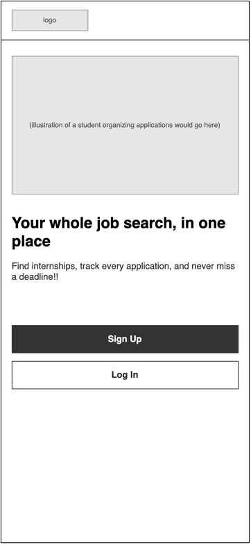

#### 2. Log In

Returning users log in with their email and password.

- After a successful login, the user goes to **Home**.
- "Sign up" at the bottom goes to **Sign Up**.

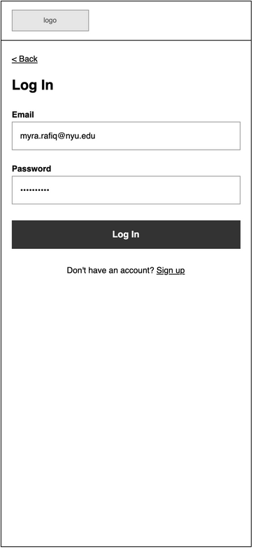

#### 3. Log In with Error

What Log In looks like if the email or password is wrong. An error message shows up above the Log In button and the password field is cleared so the user can try again.

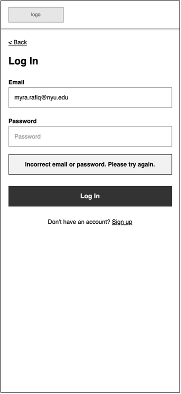

#### 4. Sign Up

New users create an account with their name, school email, and a password.

- The two password fields have to match before the account is created. An email already in use or mismatched passwords shows **Sign Up Error** (screen 5), using the same message-box style as Log In with Error.
- After signing up, the user goes straight to **Profile Setup**.

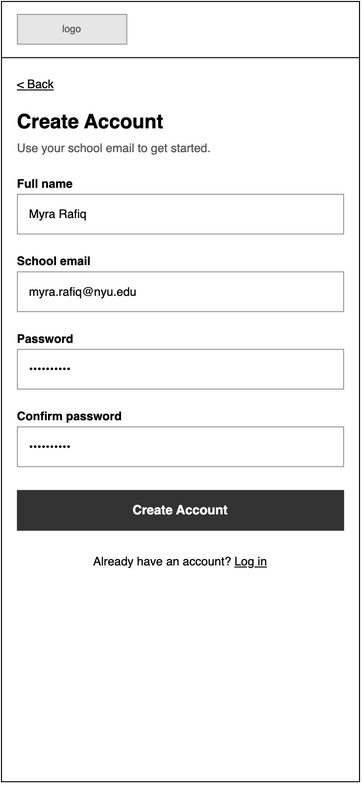

#### 5. Sign Up Error

The Sign Up form after an email already in use or a password mismatch. The message appears below Confirm password and above Create Account, matching the square gray error box on Log In with Error:

> Email in use or passwords don't match. Sign in or use matching passwords.

Users can correct their entries and retry Create Account, or use the existing Log in link to sign in. The form keeps its entered name/email and masked password fields visible.

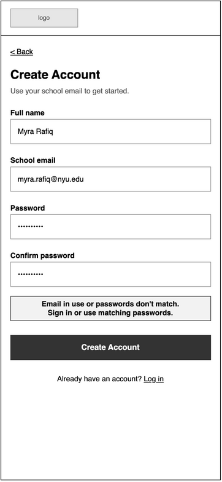

#### 6. Profile Setup

Collects the info CareerHive uses to recommend jobs and calculate AI match scores: major, graduation date, skills, the type of roles they want, preferred locations, and work authorization.

- Typing a skill or location and pressing enter adds it as a tag below the field. Tapping a tag removes it.
- The work authorization answer is used to point out jobs that offer visa sponsorship, which matters a lot for international students.
- "Skip for now" takes the user to Home. They can fill out their profile later from **Edit Profile**, but recommendations won't be as good until they do.

---

### Home and Navigation

#### 7. Home

The dashboard a user sees after logging in. It shows what needs their attention right now:

- **Upcoming Deadlines**: the next few application deadlines from their tracker. Tapping one opens its **Application Details**. "See all" goes to **Deadlines**.
- **My Applications**: how many applications are in each stage. Tapping a box opens **My Tracker** filtered to that stage.
- Stages with zero applications are hidden from the summary and tracker. They remain available when choosing an application's stage.
- **Recommended for You**: jobs that match the user's profile, with their AI match percentage. Tapping a card opens **Job Details**.

#### 8. Home with Menu Open

Tapping the menu button on any logged-in screen slides this menu in from the right. It links to every main section and has the Log Out option. Tapping "Close" or the darkened area closes it. Home is shown underneath, but the menu works the same way from every screen.

---

### Finding Jobs

#### 9. Browse Jobs

Lists the internships and entry-level jobs on CareerHive. Users can search by title, company, or skill.

- The tags under the search bar are the filters currently applied. Tapping one removes that filter.
- "Sort" is a regular dropdown with three options: best match, deadline (soonest first), and newest.
- Each card shows the AI match score, whether the company sponsors visas, and the deadline, so users can decide quickly if it's worth opening.

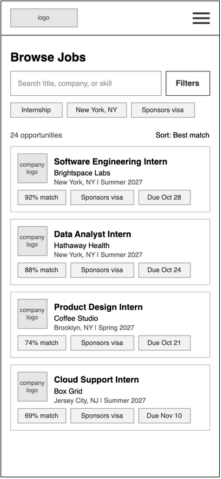

#### 10. Browse Jobs with Filters Open

Tapping "Filters" opens this panel from the bottom of the screen. Users can filter by job type, location, visa sponsorship, and deadline. The button shows how many results match and closes the panel when tapped. "Clear all" resets every filter.

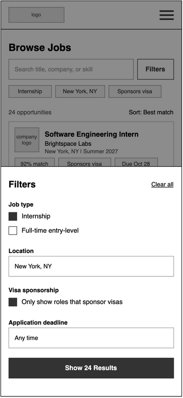

#### 11. Job Details

The full page for one job listing.

- The info box at the top has the deadline, posting date, visa sponsorship / work authorization info, and pay.
- **Save to Tracker** adds the job to the user's tracker (see screen 12). Once it's saved, the button changes to show the current stage, like "In Tracker: Saved", and tapping it opens the application in **My Tracker**.
- **Apply on Company Site** opens the company's official application page in a new tab. CareerHive doesn't handle the actual application just yet.
- **AI Match** gives a short summary of how well the job fits the user's profile. "See full analysis" opens the full breakdown (screen 13).
- **Discussion** previews the two most recent posts. "View all" opens **Job Discussion**.

#### 12. Job Details with Save to Tracker

A pop-up that opens when the user taps "Save to Tracker". They choose which stage the application starts in (Saved by default) and can add a note. Tapping "Save" adds it to the tracker and closes the pop-up.

#### 13. Job Details with AI Match Analysis

A pop-up that opens from "See full analysis". It compares the user's profile with the job description and shows:

- the overall match score
- why the job could be a good fit
- skills from the listing the user doesn't have yet
- a short summary of the key qualifications

There's a note at the bottom reminding users this is AI-generated and they should still read the full listing.

#### 14. Job Discussion

A public discussion board for one job listing, where applicants share things like interview timelines, online assessments, sponsorship info, and application updates.

- The topic tags at the top filter the posts. "All" is selected by default.
- Every post is tagged with a topic so it's easy to find specific info.
- Posts are listed newest first.

#### 15. Job Discussion with New Post

A pop-up for writing a new post. The user picks a topic, writes their post, and can choose to post anonymously. Tapping "Post" adds it to the top of the discussion.

---

### Tracking Applications

#### 16. My Tracker

Shows every job the user has saved, grouped by stage: Interview, Applied, Preparing, Saved, Offer, and Rejected. Stages with no applications are hidden; Offer is omitted from this example because its count is zero.

- The "Stage" dropdown shows just one stage, and "Sort" orders applications by deadline or by last updated. The example uses last updated, newest first within each stage.
- Each nonempty stage previews up to two applications. A stage with one application shows one; it is not padded with dummy items. The link reads "Show N more", where N is the stage total minus the visible count, and is omitted when nothing remains.
- Application cards are 328 × 72px with an 8px gap. Card text uses the same insets throughout, so adding a second item does not change its appearance.
- Tapping an application opens **Application Details**.

#### 16a. My Tracker with Saved Expanded (source page 24)

The Saved group shows all four applications after "Show 2 more" is tapped. Other stages keep their two-item preview. "Show less" collapses Saved back to two items. This example makes the preview/expansion behavior explicit without changing the navigation or card dimensions.

#### 17. Application Details

Where the user manages a single application.

- Shows the current stage, the deadline and how many days are left, and a history of when the application moved between stages.
- Users can write notes, like referrals or reminders to follow up, and save them.
- "View job listing" opens the original **Job Details** page.
- "Update Stage" and "Remove from Tracker" open pop-ups (screens 18 and 19).

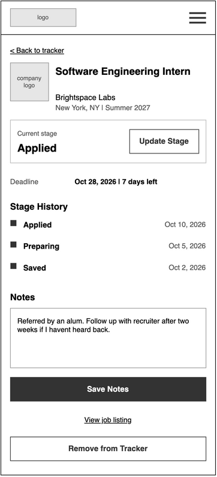

#### 18. Application Details with Update Stage

A pop-up for moving the application to a different stage. The current stage is selected when it opens. After tapping "Update", the new stage and today's date are added to the stage history.

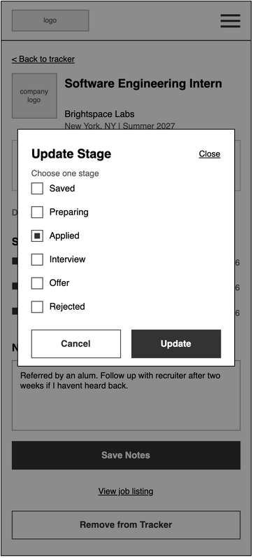

#### 19. Application Details with Remove Confirmation

Asks the user to confirm before an application and its notes are removed from their tracker, since this can't be undone. Tapping "Remove" takes them back to **My Tracker**.

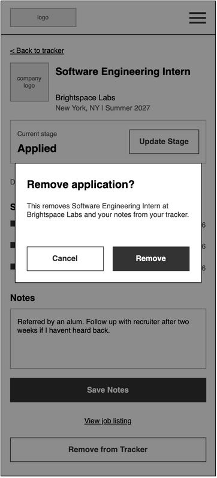

---

### Deadlines

#### 20. Deadlines

Lists upcoming deadlines for every job in the user's tracker, soonest first, so nothing gets missed.

- The tabs at the top switch between this week, this month, and all deadlines.
- Each row shows the date, the job, which stage it's in, and how many days are left.
- Tapping a row opens its **Application Details**.
- Jobs in the Offer or Rejected stage aren't shown here.

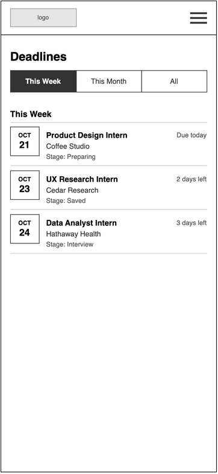

---

### Profile

#### 21. My Profile

Shows the info the user entered during Profile Setup: education, skills, the types of roles they want, preferred locations, and work authorization. "Edit Profile" lets them change it, and "Log Out" signs them out and goes back to **Welcome**.

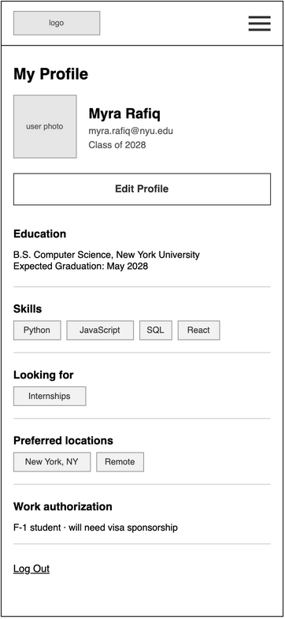

#### 22. Edit Profile

The same form as Profile Setup, with the user's current info already filled in. Users can also change their name and profile photo here. "Save Changes" updates their profile, and job recommendations and match scores change to reflect it. "Cancel" goes back without saving.

#### 23. Edit Profile with Change Photo

Tapping "Change photo" on Edit Profile (page 22) opens this popup over the dimmed form. It uses the same square dialog, top-right Close link, and bottom Cancel/Update controls as Update Stage (page 18).

- The centered gray placeholder represents the existing profile photo.
- **Take Photo Now** and **Choose from Album** are the two photo-source choices beneath it.
- **Close** and **Cancel** dismiss the popup without applying a change. **Update** confirms the photo choice and returns to Edit Profile; the form's Save Changes action remains responsible for saving the edited profile.
- Camera access, album browsing, and selected-photo preview states are outside the scope of these wireframes, as agreed. No downstream camera/album screens have been added.

